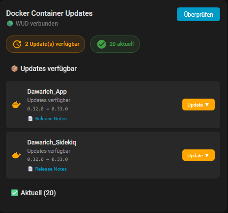
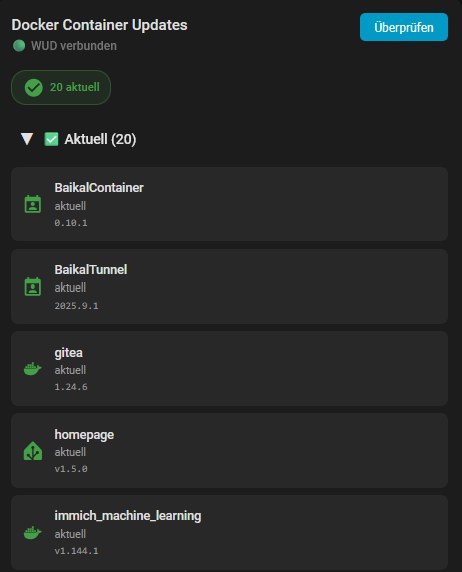
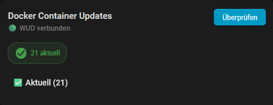
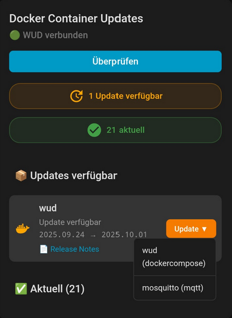

# What's up Docker Card for Home Assistant

A custom Lovelace card for Home Assistant that displays Docker container updates and integrates with [What's Up Docker (WUD)](https://github.com/fmartinou/whats-up-docker) and its successor [Drydock](https://github.com/getwud/wud) to trigger updates directly from the UI.

[](https://github.com/custom-components/hacs)

## Features

- Display available container updates from Home Assistant update entities
- Works with both **MQTT** and **HTTP** WUD integrations
- **API-only mode** — works entirely without HA entities if only the WUD API is reachable
- Compatible with **WUD** and **Drydock v1.4.0+** (automatic API path and response format detection)
- Trigger container updates via WUD API, including multiple triggers per container
- Skip updates to defer them to a separate collapsible section
- Container names resolved from HA `friendly_name`, with configurable rewriting rules
- Multi-language support (English, German)
- Customizable icons per container
- Release notes links with template support
- Collapsible up-to-date and skipped sections
- Responsive design for mobile devices

## Screenshots






## Installation

### HACS (Recommended)

1. Open HACS in Home Assistant
2. Click on "Frontend"
3. Click the 3-dot menu in the top right corner
4. Click "Custom repositories"
5. Add this repository URL: `https://github.com/angryvoegi/wud-card`
6. Select category: "Dashboard"
7. Click "Add"
8. Find "What's Up Docker Card" in the list and click "Install"
9. Refresh the frontend

### Manual Installation

1. Download `wud-card.js`
2. Copy it to `www/wud-card.js`
3. Add the following to your `configuration.yaml`:

```yaml
lovelace:
  resources:
    - url: /local/wud-card.js
      type: module
```

4. Restart Home Assistant

## Configuration

### Minimal Configuration

```yaml
type: custom:wud-card
```

### Full Configuration Example

```yaml
type: custom:wud-card
title: Docker Container Updates
entity_filter:
  - whats_up_docker
  - wud_container
prefixes:
  - local
show_current: true
show_available_updates: true
current_collapsed: true
enable_skip: true
update_interval: 30000
wud_api:
  url: http://your-wud-instance:3000
  api_path: /api/v1                    # Optional; auto-detects /api/v1 then /api when omitted
  show_update_buttons: true
  auth: your_bearer_token_here         # Bearer token (takes priority)
  user: your_username                  # Basic auth (used if auth is not set)
  password: your_password
  trigger_filter: all
container_name_transform: auto        # auto | raw | custom
name_replacements:                    # only used with container_name_transform: custom
  - from: "wud "
    to: ""
    fromIsRegex: false
release_notes:
  home-assistant: https://github.com/home-assistant/core/releases/tag/{latest}
  traefik: https://github.com/traefik/traefik/releases/tag/v{latest}
  nginx: https://nginx.org/en/CHANGES-{version}
custom_icons:
  plex: mdi:plex
  jellyfin: mdi:jellyfin
  frigate: mdi:cctv
```

### Configuration Options

| Option                        | Type            | Default                                    | Description                                                        |
|-------------------------------|-----------------|--------------------------------------------|--------------------------------------------------------------------|
| `title`                       | string          | Auto (translated)                          | Card title                                                         |
| `entity_filter`               | string or array | `['whats_up_docker', 'wud_container']`     | Substring filter for update entity IDs                             |
| `prefixes`                    | string or array | `['local']`                                | WUD host/stack prefixes to strip when falling back to entity ID    |
| `show_current`                | boolean         | `true`                                     | Show up-to-date containers                                         |
| `show_available_updates`      | boolean         | `true`                                     | Show containers with available updates                             |
| `current_collapsed`           | boolean         | `true`                                     | Initially collapse the up-to-date section                          |
| `enable_skip`                 | boolean         | `false`                                    | Show a Skip button on each pending update (see below)              |
| `update_interval`             | number          | `30000`                                    | Interval in ms to refresh WUD API data                             |
| `wud_api.url`                 | string          | —                                          | URL of your WUD instance                                           |
| `wud_api.api_path`            | string          | Auto (`/api/v1`, then `/api`)              | API base path override (`/api` for legacy WUD servers)             |
| `wud_api.show_update_buttons` | boolean         | `true`                                     | Show update trigger buttons                                        |
| `wud_api.auth`                | string          | —                                          | Bearer token for WUD API authentication                            |
| `wud_api.user`                | string          | —                                          | Username for WUD Basic authentication                              |
| `wud_api.password`            | string          | —                                          | Password for WUD Basic authentication                              |
| `wud_api.trigger_filter`      | string or array | `all`                                      | Limit triggers by type or name, e.g. `dockercompose`, `mqtt`       |
| `container_name_transform`    | string          | `auto`                                     | Name handling: `auto`, `raw` or `custom` (see below)               |
| `name_replacements`           | array           | `[]`                                       | Rewrite rules, only applied with `container_name_transform: custom`|
| `release_notes`               | object          | `{}`                                       | Template URLs for release notes (see below)                        |
| `custom_icons`                | object          | `{}`                                       | Custom MDI icons per container name                                |

> Any option not listed here is silently ignored. The card does not validate its
> configuration, so a typo or an invented key produces no error message — it simply
> has no effect. If a setting appears to do nothing, check the spelling against this table.

### Skip Updates

Enable the skip feature with `enable_skip: true`. A **Skip** button then appears below the Update button on every pending update (same size, column layout — no change in row height).

```yaml
type: custom:wud-card
enable_skip: true
```

**How it works:**

- **Skip** — moves the container out of *Updates Available* into a collapsible **Skipped Updates** section
- **Unskip** — moves it back to *Updates Available* without triggering an update
- **Update** (from the skipped section) — triggers the update and automatically unskips the container

The skipped state is stored in `localStorage` under the key `wud-card-skipped` and persists across page reloads. The summary row shows a separate chip with the number of skipped containers.

> Because it lives in `localStorage`, the skip list is **per browser and per device**. It is not synced between your phone and desktop, is not shared between Home Assistant users, and is lost when browser data is cleared. Skipping is also permanent until you unskip — a newer version of an already skipped container does not resurface it automatically.

### Authentication

Only one method is used at a time. Bearer token (`auth`) takes priority over Basic auth (`user` + `password`).

> Credentials in a Lovelace config are delivered to the browser and are visible to anyone who can view the dashboard or open DevTools. Use a token scoped to WUD only.

### WUD and Drydock API Compatibility

The card speaks to both WUD and its successor Drydock without extra configuration:

- **API path** — when `api_path` is not set, the card tries `/api/v1` first and falls back to `/api` on a 404. Set `api_path` explicitly to pin one (`/api` for legacy WUD servers) and skip the probing.
- **Response format** — both bare arrays and Drydock v1.4.0+ envelopes (`{ data, total }`) are unwrapped automatically.
- **Container matching** — HA entities are matched against WUD containers using `id`, `name`, `displayName`, `identityKey` (including its `::` segments), `image.name`, `com.docker.compose.service` and `org.opencontainers.image.title`. Comparison is case-insensitive and ignores non-alphanumeric characters, but is never substring-based — so `baikal` does not accidentally match `baikaltunnel`.
- **Distributed agents** — trigger URLs include the optional `agent` segment when a trigger reports one.

### API-Only Mode

If **no** Home Assistant `update.*` entity matches your `entity_filter`, the card falls back to building its list purely from the WUD API. These synthetic entities use a `wud_api.` prefix instead of `update.`.

This means the card works with nothing but a reachable WUD API — no MQTT and no HA integration required. Two limitations apply in this mode: clicking a row cannot open the Home Assistant more-info dialog (there is no HA entity behind it), and versions come from `image.tag.value` and `result.tag` instead of HA attributes.

As soon as at least one matching HA entity exists, HA entities take precedence and the API is used only for names and triggers.

### The `show_update_buttons` Gotcha

`wud_api.show_update_buttons: false` does more than hide the buttons — it stops the card from querying the WUD API at all. That also disables the connection indicator, the "Check for Updates" button, trigger discovery and API-based name resolution.

To keep the API connection but hide only the update buttons, leave `show_update_buttons` at `true` and set `trigger_filter` to a type that matches nothing.

### Card Interactions

| Element | Behaviour |
|---------|-----------|
| Container row | Opens the Home Assistant more-info dialog for that entity |
| **Update** | Triggers the update; with several matching triggers the button becomes an `Update ▼` dropdown listing each trigger as `name (type)` |
| **Check for Updates** | Sends `POST /containers/watch` to WUD and reloads the card data after ~3 seconds |
| 🟢 / 🔴 indicator | Whether the last WUD API request succeeded; only shown when `show_update_buttons` is `true` |
| Section headers | Collapse or expand the up-to-date and skipped sections |

### Container Name Resolution

The card resolves container display names in this priority order:

1. **`friendly_name` from the HA entity** — set by WUD via MQTT or the HA integration, and respects `wud.display.name` labels.
2. **WUD API container name** — used if the WUD API is configured and the container is matched.
3. **Entity ID fallback** — strips `update.`, the integration prefixes (`whats_up_docker_container_`, `wud_container_`) and any `prefixes` entries, then humanises the remainder.

Even without the WUD API configured, names display correctly as long as the HA entities have a `friendly_name` — which they do when using the WUD MQTT or HTTP integration.

**Important:** `prefixes` only affects step 3. As soon as an entity has a `friendly_name`, step 1 wins and `prefixes` is never consulted. To clean up a `friendly_name`, use `container_name_transform` below.

#### `container_name_transform`

Home Assistant prepends the integration or MQTT device name to `friendly_name`. Which prefix you get depends on your WUD version and integration:

| Your `friendly_name` looks like | Handled by |
|---------------------------------|------------|
| `Whats Up Docker immich` / `What's Up Docker pihole` | `auto` — stripped automatically |
| `wud mariadb` (seen on WUD 8.3.x MQTT discovery) | `custom` — needs a rule, see below |

| Mode     | Behaviour                                                                                          |
|----------|----------------------------------------------------------------------------------------------------|
| `auto`   | Default. Strips a leading `What's Up Docker` / `Whats Up Docker` and capitalises the first letter.  |
| `raw`    | Uses `friendly_name` exactly as Home Assistant delivers it — no stripping, no capitalisation.       |
| `custom` | Like `auto`, then applies every `name_replacements` rule in order.                                  |

#### `name_replacements`

Each rule takes three fields:

| Field         | Required | Description                                                          |
|---------------|----------|----------------------------------------------------------------------|
| `from`        | yes      | Text or regular expression to search for                             |
| `to`          | no       | Replacement text; defaults to `""` (delete)                          |
| `fromIsRegex` | no       | `true` treats `from` as a regular expression; defaults to `false`     |

Matching is **case-insensitive** and replaces **all** occurrences, so a rule written as `wud ` also matches an already-capitalised `Wud `.

```yaml
type: custom:wud-card
container_name_transform: custom
name_replacements:
  - from: "wud "
    to: ""
    fromIsRegex: false
  - from: "^prod[-_]"
    to: ""
    fromIsRegex: true
```

With this config, `wud mariadb` renders as **Mariadb** and `wud BaikalTunnel` as **BaikalTunnel**.

Two safety rules apply: an invalid regular expression is skipped with a warning in the browser console rather than breaking the card, and a rule that would reduce a name to an empty string is discarded so the original name survives.

> Rules that strip `update.` or `wud_container_` prefixes are unnecessary — those are already removed unconditionally in step 3, and they never appear in a `friendly_name` to begin with.

### Release Notes Templates

Configure per-container release notes links using placeholders:

| Placeholder    | Value                            |
|----------------|----------------------------------|
| `{installed}`  | Currently installed version      |
| `{latest}`     | Latest available version         |
| `{version}`    | Alias for `{latest}`             |
| `{name}`       | Container name                   |

**Example:**

```yaml
release_notes:
  ntfy: https://github.com/binwiederhier/ntfy/releases/tag/v{version}
  traefik: https://github.com/traefik/traefik/releases/tag/v{latest}
```

> Note the URL pattern varies per project (some use a `v` prefix, some don't). Check the repository's releases page.

Keys are matched case-insensitively. An exact match wins; otherwise the card falls back to substring matching in **both** directions (key contained in name, or name contained in key) and picks the longest matching key. Placeholder values are URL-encoded when inserted.

`{version}` resolves to `latest_version`, falling back to `installed_version` when no update is pending — which is why up-to-date containers still produce a usable link.

### Custom Icons

Map container names to [Material Design Icons](https://pictogrammers.com/library/mdi/):

```yaml
custom_icons:
  plex: mdi:plex
  jellyfin: mdi:jellyfin
  homeassistant: mdi:home-assistant
  frigate: mdi:cctv
  prometheus: mdi:chart-line
```

Matching is case-insensitive and substring-based (e.g. `traefik` matches a container named `traefik-proxy`).

#### Built-in icon mappings

| Container    | Icon                  |
|--------------|-----------------------|
| `traefik`    | `mdi:router-network`  |
| `mosquitto`  | `mdi:message-outline` |
| *(default)*  | `mdi:docker`          |

## What's Up Docker Integration

This card works with the [What's Up Docker integration](https://github.com/custom-components/whats_up_docker) for Home Assistant, via either **MQTT** or **HTTP API**.

### Prerequisites

1. Install and configure WUD: https://github.com/fmartinou/whats-up-docker
2. Connect WUD to Home Assistant via MQTT or the HA integration
3. *(Optional)* Configure WUD triggers (docker compose, watchtower, etc.) to enable update buttons

### WUD Docker Compose Example

```yaml
services:
  whatsupdocker:
    image: getwud/wud:8.1.1
    container_name: wud
    ports:
      - "3000:3000"
    user: "0:0"
    volumes:
      - /var/run/docker.sock:/var/run/docker.sock
      - /PATH/TO/YOUR/WUD/docker-compose.yml:/wud/docker-compose.yml
      - /PATH/TO/YOUR/app/docker-compose.yml:/compose/app.yml
    environment:
      # Enable CORS so the card can reach the WUD API from the browser
      - WUD_SERVER_CORS_ENABLED=true
      - WUD_SERVER_CORS_ORIGIN=*
      - WUD_SERVER_CORS_METHODS=GET,HEAD,PUT,PATCH,POST,DELETE

      # Trigger: update WUD itself via docker compose
      - WUD_TRIGGER_DOCKERCOMPOSE_DEFAULT_EXCLUDE=true
      - WUD_TRIGGER_DOCKERCOMPOSE_WUD_FILE=/wud/docker-compose.yml

      # Trigger: update a specific app
      - WUD_TRIGGER_DOCKERCOMPOSE_APP_FILE=/compose/app.yml
      - WUD_TRIGGER_DOCKERCOMPOSE_APP_THRESHOLD=minor
      - WUD_TRIGGER_DOCKERCOMPOSE_APP_DRYRUN=false
    labels:
      - wud.tag.include=^\d+\.\d+\.\d+$
      - wud.trigger.include=dockercompose.wud,mqtt.mosquitto
```

> Add `wud.tag.include` and `wud.trigger.include` labels to the containers you want to watch. See the [WUD documentation](https://getwud.github.io/wud/#/configuration/) for all options.

## Language Support

The card automatically uses your Home Assistant language setting:

- German — when the HA language starts with `de`
- English — for every other language

To add more languages, extend the `TRANSLATIONS` object in `wud-card.js` (and kindly open a pull request).

Note that the card title is translated only when you do not set `title` yourself; a configured `title` is used verbatim in every language.

## Troubleshooting

### Container names are wrong or show the entity ID

The card reads `friendly_name` from the HA entity first. If names are wrong, check:

1. Open **Developer Tools → States** and find your `update.*` entity
2. Confirm `friendly_name` is set correctly in the entity attributes
3. If using MQTT: verify WUD publishes the correct name (check `wud.display.name` label on the container)

### Container names carry a `wud` or other prefix

Your `friendly_name` contains a device prefix that `auto` mode does not know. Read the actual value in **Developer Tools → States**, then strip it with `container_name_transform: custom` and a matching `name_replacements` rule. Adding `prefixes` entries will not help here — `prefixes` never applies to `friendly_name`.

### A configuration option seems to have no effect

The card ignores unknown keys without warning. Verify the option against the table in [Configuration Options](#configuration-options) — a misspelled or non-existent key fails silently.

To prove whether a `name_replacements` rule runs at all, temporarily set its `to` value to something unmistakable such as `ZZZTEST` and reload the dashboard. If no name changes, the rule is not being applied.

### No containers shown

1. Check **Developer Tools → States** for entities starting with `update.`
2. Confirm the entity IDs contain one of the strings in your `entity_filter`
3. Default filter matches `whats_up_docker` and `wud_container` — adjust if your entity IDs differ

### WUD API not connecting

1. Verify the WUD URL is reachable from the browser (not just from HA server)
2. Enable CORS in WUD (`WUD_SERVER_CORS_ENABLED=true`)
3. Check authentication configuration (Bearer token or Basic auth)
4. Open browser DevTools (F12) → Network tab for detailed errors

### Update buttons not appearing

1. Set `wud_api.show_update_buttons: true` in config
2. Verify WUD triggers are configured and the card can reach the API (green status indicator)
3. Check `trigger_filter` — if set to a specific type, only matching triggers are shown

## Changelog

### Unreleased

- **`container_name_transform` / `name_replacements`** — rewrite container display names with plain-text or regex rules, for `friendly_name` prefixes that `auto` mode does not cover.

### v1.6.0

- **Drydock v1.4.0+ support** — data envelopes (`{ data, total }`) and bare arrays are both detected.
- **API path auto-detection** — tries `/api/v1`, falls back to `/api`; override with `api_path`.
- **Enhanced container matching** — considers `identityKey`, `com.docker.compose.service`, `org.opencontainers.image.title` and `image.name`.
- **API-only entities** — WUD containers are rendered as `wud_api.` entities when no HA `update.*` entities are available.
- **Trigger path with optional `agent` segment** — supports remote agent setups such as Drydock Distributed Agents.

### v1.5.0

- **Skip / unskip** — defer pending updates into a separate collapsible section.

## Contributing

Contributions are welcome! Please feel free to submit a Pull Request.

## License

MIT License — see [LICENSE](LICENSE) file for details

## Credits

- Built for integration with [What's Up Docker](https://github.com/fmartinou/whats-up-docker)
- Inspired by various Home Assistant custom cards
- Made with AI (Claude)
